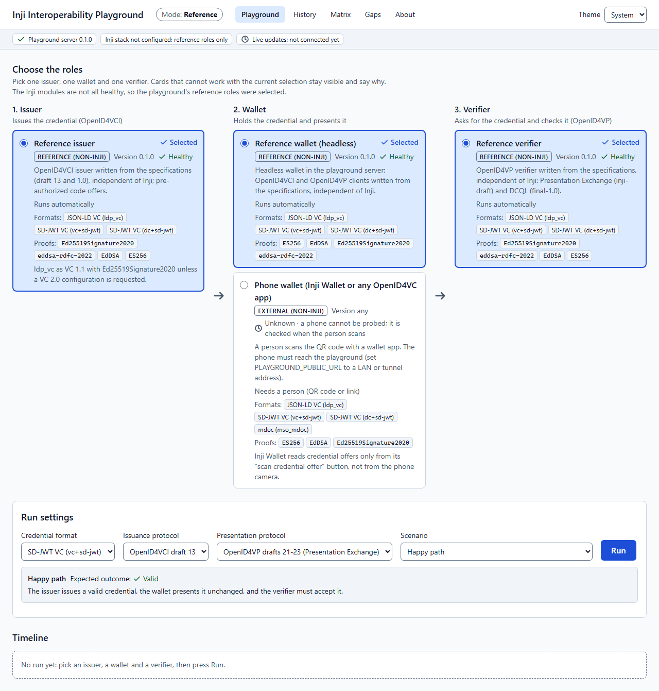
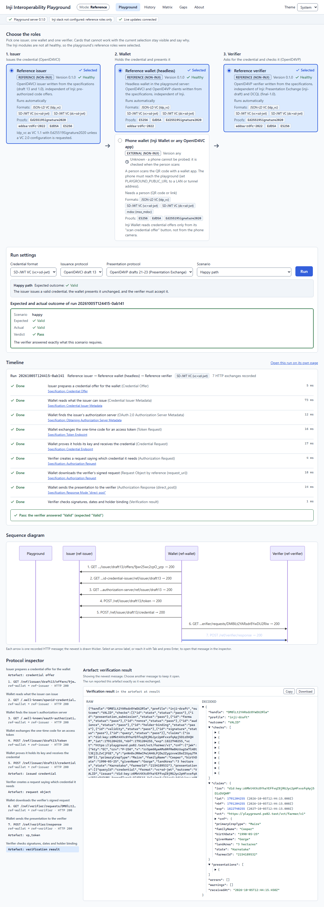
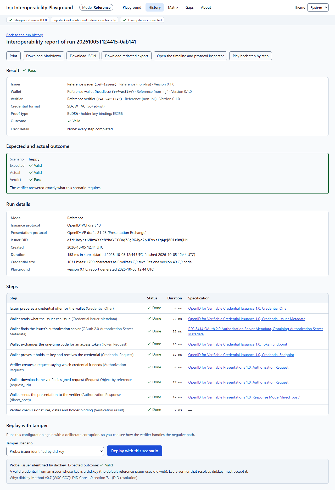
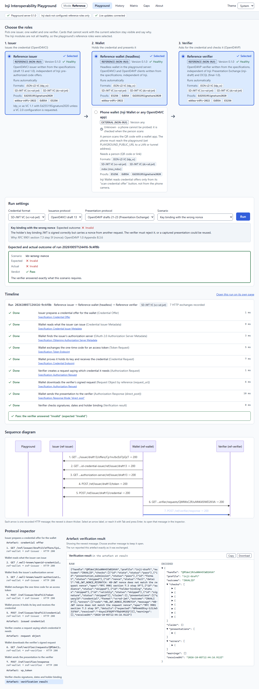
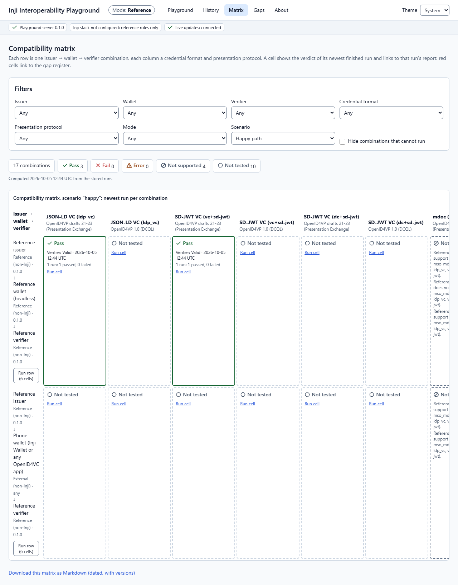
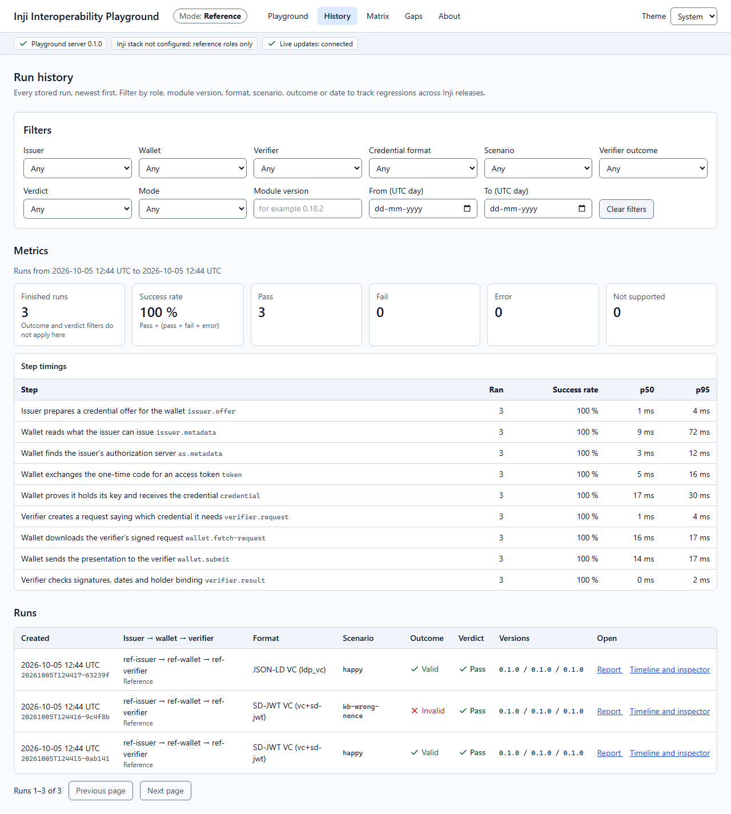
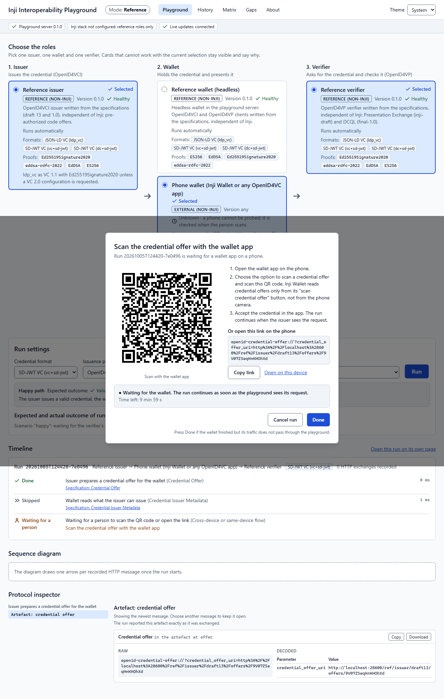

# User flow

How a person uses the playground, shown with screenshots that the browser tests capture
(`npm run e2e -- --screenshots`, Chromium, reference mode, 2026-10-05). Every screenshot comes from a real
run against the playground server with its reference roles; nothing is mocked.

## 1. Choose the roles and the run

Three columns, issuer → wallet → verifier, with a card per registered role: whether it is an Inji module,
a reference role or an external wallet, its version, health, how it runs and what it supports. A card that
cannot work with the other two selections stays visible and says why. Under the cards the run settings
offer only the formats and protocol versions every chosen role supports, and the scenario picker shows,
before the run, what a correct verifier must answer and the specification text behind it.

## 2. Follow the run

Run starts the run and the timeline follows it live: one row per protocol step with the plain-language
label first and the protocol term second, the status as an icon and a word, the duration and the
specification section. Below it the sequence diagram and the protocol inspector show the same run's
recorded HTTP messages, decoded.

## 3. Read the report

The report page holds the fields of the interoperability report (issuer, wallet, verifier, format, proof
type, outcome, error detail with a link to the failing message), the expected and actual outcome, the
steps with timings, and Markdown, JSON and redacted-export downloads. "Replay with tamper" runs the same
configuration again with a negative scenario.

## 4. Try a negative path

With a tamper scenario (here a key binding JWT bound to another nonce), the run bar puts the expected
outcome next to the verifier's actual answer once the run ends, with a sentence that explains the result.

## 5. Compare combinations and track history

The matrix shows the newest verdict of each issuer → wallet → verifier combination per format and
protocol version, as an icon and a word, linked to the run's report; combinations that cannot run say why.
The history lists every stored run with filters that live in the page address.

## 6. Use a phone wallet

With the phone wallet, the run waits for a person: a modal shows the credential offer (then the
presentation request) as a QR code and as a link with a copy button, the steps in plain words and the time
left. The run continues by itself when the playground sees the wallet's request, or when the person
presses Done for traffic it cannot see.

## Accessibility checks

- `npm run e2e` runs axe-core (WCAG 2.1 A and AA rules) in Chromium on the playground, matrix, history,
  report and about pages and fails on any serious or critical violation; on 2026-10-05 there were none.
- One test drives the happy path with the keyboard only: Tab to Run, Enter, Tab to the run, Enter, Tab to
  the report, Enter.
- Statuses are always an icon plus a word; colour contrast of both themes is checked from the design tokens
  (`packages/web/test/theme-contrast.test.ts`).
